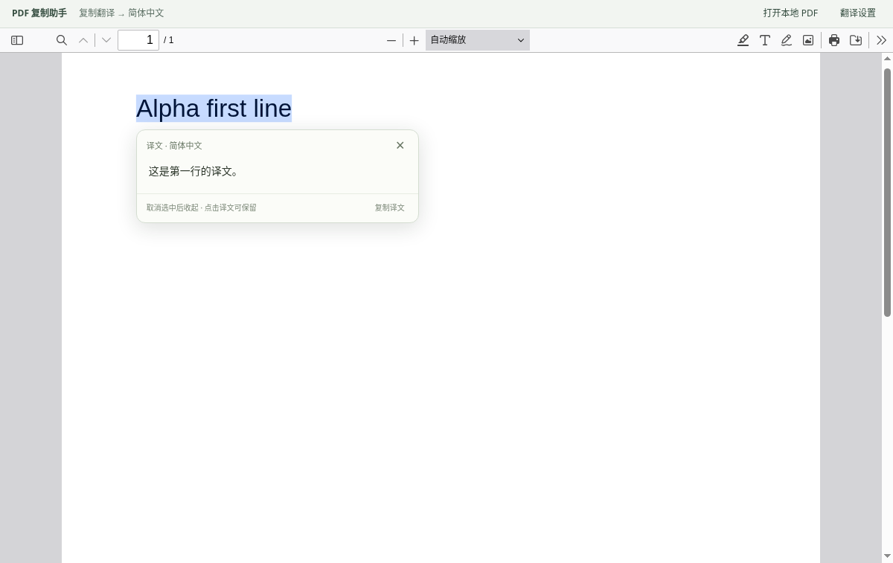

# PDF 复制助手 · v1.2.1

桌面版 Chrome / Edge 扩展：复制 PDF 时将所有换行替换为空格，并提供复制翻译浮窗。无需 Node.js 或构建工具。

[下载最新版本](https://github.com/Dioxane123/pdf-copy-translation/releases/latest) · [v1.2.1 安装包](https://github.com/Dioxane123/pdf-copy-translation/releases/download/v1.2.1/pdf-copy-cleaner-1.2.1.zip) · [反馈问题](https://github.com/Dioxane123/pdf-copy-translation/issues)



预览使用生成的测试文档和模拟译文，只演示界面与交互。

## 安装或更新

1. 解压 `pdf-copy-cleaner-1.2.1.zip` 到固定目录。
2. 打开 `chrome://extensions/` 或 `edge://extensions/`，开启「开发者模式」。
3. 点击「加载已解压的扩展程序」，选择包含 `manifest.json` 的 `pdf-copy-cleaner` 目录。
4. 若已安装旧版：用新版文件覆盖**原目录**，在扩展管理页点击「重新加载」，刷新已打开的 PDF 和阅读模式标签页。不必卸载旧版，设置会保留。
5. 要从本地文件网址直接打开 PDF，在扩展详情开启「允许访问文件网址 / 文件 URL」。也可在阅读模式中点击「打开本地 PDF」，该文件选择方式无需此权限。

请使用当前桌面版 Chrome / Edge。原有剪贴板功能最低需要 Chrome 116 级别的 API；新增阅读模式捆绑 PDF.js 6.4.299 的现代构建，面向最新浏览器，不保证旧版浏览器可运行。

## 开始使用复制翻译

1. 点击扩展图标 → **翻译设置**。
2. 勾选「开启复制翻译」，选择服务与目标语言，点击「保存设置」。默认目标语言为**简体中文**，自动识别原文语言。
3. 在 PDF 标签页点击扩展图标 → **用翻译阅读模式打开**。会在新标签页打开同一份 PDF，也可直接选择本地文件。
4. 选中一句话并按 Ctrl+C（macOS 为 Command+C），或右键复制。原文选区旁出现轻量译文浮窗，不抢夺键盘焦点。

浮窗规则：

- 只选中文字而没有复制时，不发起翻译。
- 取消原文选中后，浮窗收起；尚未完成的翻译会取消，迟到的结果不会重新弹出。
- 点击浮窗或选中译文后，浮窗显示「已保留」。即使原文选区消失，也可继续查看、选择或复制译文。
- 返回 PDF 点击空白处，或按 Esc、点右上角 ×，即可关闭。
- 复制另一段原文时显示新译文，旧请求不会覆盖它。重复复制同一句也会触发。
- 剪贴板中仍是换行转空格后的**原文**。需要译文时点击「复制译文」或自行选中译文复制；不会再次触发翻译。
- 翻译失败会显示错误及重试按钮。单次限 12,000 字符，默认 25 秒超时；模型翻译可将等待上限设为 10–180 秒。第三方服务可能有更低限制。

当前内置 PDF 阅读器不向扩展可靠开放选区变化，所以**翻译浮窗仅在扩展 PDF 阅读模式中提供**。Chrome / Edge 自带阅读器继续支持原有的换行转空格功能。

## 翻译服务

### 谷歌翻译

选择「谷歌翻译 · 无需密钥」并保存即可。需要能访问 Google；该免密钥接口并非 Google Cloud 的正式 API，可能被限流、变更或不可用。出现连接错误时，可检查网络或改用自定义模型。不会在失败时自动将文字转发到另一服务。

### 自定义模型

支持常见的 Chat Completions 兼容接口。填写：

- **模型预设**：通用兼容接口、GPT 参数模板或 DeepSeek 参数模板。
- **Base URL**：例如 `https://api.example.com/v1`，自动补上 `/chat/completions`；也支持填写完整端点。
- **模型名称**：服务商要求的 `model` 值。
- **API_KEY**：服务商提供的密钥。
- **加密口令**：自行设置，至少 8 个字符，用于加密密钥。

使用非流式 `POST` 请求、`Authorization: Bearer …`、`model` 和 `messages` 字段，从 `choices[0].message.content` 读取译文。仅支持 HTTPS；本机 `localhost` / `127.0.0.1` / `[::1]` 可以使用 HTTP。接口不得依赖重定向，API 请求不会附带网站 Cookie。

保存新密钥后，本次浏览器会话自动解锁。重启浏览器后，在「翻译设置 → 密钥保险箱」输入口令解锁。立即锁定和删除密钥按钮也在该处。

修改模型名或目标语言时，可将 API_KEY 与加密口令留空；修改服务地址时必须重新填写密钥和口令。自定义模型的费用及可用性由所配置服务商决定。

### GPT / DeepSeek 预设模板（v1.2.0）

在「翻译服务 → 模型翻译」中选择模型预设。**两个模板都支持自定义 Base URL 和模型别名，不通过域名判断厂商，也不会覆盖已填写的地址和模型名。** 只有空白字段会填入该模板的官方示例。

| 模板 | 可调设置 | 发送的 Chat Completions 字段 |
| --- | --- | --- |
| GPT | 推理开关与强度 | `reasoning_effort`；`none` 表示关闭，部分型号不支持关闭 |
| GPT | 处理速度 / 服务档位 | `service_tier`：auto、default、priority、fast、flex |
| GPT | 回答详细程度 | `verbosity`：low、medium、high |
| DeepSeek | 思考模式 | `thinking: {type: "enabled"}` 或 `"disabled"` |
| DeepSeek | 推理强度 | `reasoning_effort`：low、high、max |
| 两者 | 输出 Token 上限 | GPT 用 `max_completion_tokens`；DeepSeek 用 `max_tokens` |
| 两者 | 等待上限 | 扩展本地超时设置，不作为模型请求参数发送 |

所有可选参数默认使用「服务默认（不发送）」，Token 上限留空也不发送。旧版设置升级后使用通用模板，不额外添加厂商参数。

注意：

- 推理强度影响思考量，较低通常更快；GPT 的服务档位影响请求处理方式，不能保证固定的思考速度。Fast / Priority 可能使用不同计费，需服务商支持。
- GPT 各型号的可用档位不同。例如 GPT-6 Astra / GPT-6.1 Sol 不支持 `none` 或 `minimal`，GPT-5.1 支持 `none`；界面对这些已核对的型号会限制无效选项。未识别的型号或中转站别名由服务商决定，模板不猜测别名对应的真实模型。
- DeepSeek 关闭思考后，即使此前选择了强度，也不会发送强度参数，以免它重新启用思考。切回开启可恢复之前的强度。当前官方接口没有独立的速度档位。
- 历史 DeepSeek 别名、第三方模型版本可能不支持这些参数。不支持时改为「服务默认」或使用通用模板；扩展不会静默重试并改动你选择的推理配置。
- Token 上限包含推理开销，应留够最终译文的空间。接口返回 `finish_reason: "length"` 时会提示提高上限，不将截断内容当成完整译文。
- 高强度思考可能超过默认 25 秒，可改为 60 秒或更长。等待期间仍可取消选中，终止请求。
- 「查看将发送的额外参数」仅显示参数 JSON，不包含密钥或原文。切换模板不发送另一模板的字段；两套设置分别记忆。
- 直接使用 HTTP JSON 时，DeepSeek 的 `thinking` 位于请求顶层，不嵌套进 SDK 专用的 `extra_body`。

参数依据、型号差异和官方来源见 [MODEL_PRESETS.md](MODEL_PRESETS.md)（核对日期：2026-10-23）。

## API_KEY 的保护方式

- 磁盘中只保存 AES-256-GCM 密文、随机 16 字节盐、随机 12 字节 IV 和公开的服务配置。
- 使用 PBKDF2-SHA-256、600,000 次迭代，从解锁口令派生加密密钥；口令不保存。
- 密文与模型接口地址绑定，不能在更改地址后直接使用原密文。
- 解锁后的 API_KEY 仅放入 `chrome.storage.session` 的会话内存，供后台请求使用，重启、锁定或删除时清除；不写入磁盘或同步存储，不返回给 PDF 内容或普通网页。
- 不在日志或错误提示中输出密钥，不展示服务端的原始错误正文。

加密主要保护磁盘中的保存数据；无法防御已控制浏览器、操作系统或可读取进程内存的程序。忘记口令后，需要重新输入 API_KEY 并设置新口令。

## 换行转空格

两种阅读模式共用规则：每个逻辑换行替换为一个普通空格，CRLF 算一个换行；连续两个 LF 会变成两个空格。保留已有空格、制表符、标点和连字符。

`第一行\n第二行\r\n第三行` → `第一行 第二行 第三行`。

`hello\nworld` → `hello world`；`hello \nworld` → `hello  world`（两个空格）。

扩展阅读模式直接在复制事件中处理，**不需要等待 0.3 秒**。原有内置阅读器采用剪贴板检测，复制后请停留约 0.3 秒再粘贴。绿色 `ON` 只表示内置阅读器的剪贴板检测正在运行；扩展阅读模式在顶部显示自己的状态。

内置阅读器的检测仅在前台 PDF 标签页运行，进入 PDF 时不改动已有剪贴板；切换网页、切换应用或最小化时停止。复制后立即切走可能来不及处理，其他程序在 PDF 位于前台时更新的剪贴板也可能被处理。无 `.pdf` 后缀的链接通过 HTTP Content-Type 识别，安装后需要刷新；无法识别时可在面板手动标记当前页。

## 阅读模式与隐私

PDF.js 随扩展本地打包，文件解析和渲染在浏览器中完成。在线 PDF 会从原地址读取；本地 PDF 不会上传。PDF 内嵌 JavaScript 禁用，并遵守 PDF 的复制权限。保留 PDF.js 的搜索、缩放、分页、打印等功能。

v1.2.1 关闭了 PDF.js 默认开启的可选 WebGPU 渲染路径，使用普通渲染方式，避免不支持 WebGPU 的环境输出 `No available adapters.`。不需要修改浏览器的硬件加速或实验性开关。

控制台中的 `PDF … [版本 / 生成工具] (PDF.js: …)` 是文档元数据日志，不是报错；它本身不证明所有页面或翻译请求都成功。如果仍有空白页或翻译异常，需要结合实际界面和其他错误定位。

开启复制翻译后，只有本次复制的文字会发送给所选择的服务。扩展不保存原文或译文历史，不上传整份 PDF，不收集遥测。若使用第三方服务，其自身的数据处理规则适用。

加密的 PDF 需输入文件密码；扫描件必须本来有可选文本层，此版本不提供 OCR。部分登录网站、临时 `blob:` 地址或嵌入页面无法重新读取，下载 PDF 后使用「打开本地 PDF」即可。与浏览器原生阅读器相比，个别 PDF 的渲染可能不同。

## 权限

| 权限 | 用途 |
| --- | --- |
| `clipboardRead` / `clipboardWrite` | 原有内置阅读器剪贴板处理，以及复制译文 |
| `offscreen` | 内置阅读器后台剪贴板操作 |
| `tabs` | 判断当前 PDF 并打开扩展阅读模式 |
| `storage` | 设置、密钥密文、会话中的解锁状态 |
| `webRequest` | 读取顶层响应 Content-Type 识别 PDF，不读取响应正文 |
| HTTP/HTTPS 访问 | 读取原 PDF、访问用户选择的翻译端点 |
| `file:///*` | 从本地 PDF 地址打开文件 |

不注入普通网页，不使用 `debugger` 权限，不修改浏览器默认 PDF 打开方式。

## 验证与源码

- `node tests/core.test.mjs`：10 项换行处理与剪贴板行为测试。
- `node tests/translation.test.mjs`：6 项加密、端点校验、翻译协议与错误保护测试。
- `node tests/model-presets.test.mjs`：11 项预设、参数映射、型号限制、旧版兼容、中转地址及截断处理测试。
- `CHROME_BIN=/path/to/chrome node tests/chrome-smoke.mjs`：原有内置 PDF 阅读器的 6 项集成检查。
- `CHROME_BIN=/path/to/chrome node tests/reader-smoke.mjs`：扩展阅读模式与浮窗集成检查，使用本机模拟模型服务、虚拟密钥和生成的 PDF，覆盖真实复制、取消选中、保留浮窗、复制译文、快速连续复制、取消请求、重试、锁定解锁和本地文件。
- `CHROME_BIN=/path/to/chrome node tests/presets-smoke.mjs`：在 Chrome 中保存预设并实际复制 PDF，检查本机模拟中转服务收到的参数、切换预设、设置持久化、密钥保护与 33 秒慢响应。
- `CHROME_BIN=/path/to/chrome node tests/render-smoke.mjs /path/to/document.pdf`：检查无 WebGPU 探测及适配器警告、PDF 渲染、文字层和复制换行处理；省略文件路径时使用生成的测试 PDF。
- `python3 package.py --output-dir dist`：生成安装 ZIP 和 SHA-256 校验文件。安装包不包含截图、测试脚本、Git 数据或发布工具；这些文件保留在源码仓库中。

集成测试使用 Node.js 22+ 及独立的无界面 Chrome for Testing，不接触正常浏览器配置或桌面剪贴板。已在 Chrome for Testing 156.0.8078.47 / Linux 验证；谷歌接口另用公开示例验证返回中文。未进行 Edge 实机测试，也未使用真实的 GPT / DeepSeek 付费账号或用户的中转站进行端到端测试。

v1.2.1 使用 arXiv `2605.00080` 的公开 PDF 复现了适配器警告（文档指纹 `712b8842c92b22aff711834cd5ee7579`、43 页）；该文件下载后由本机测试服务提供，验证首屏渲染、文字选择和复制。未逐页检查全部 43 页。

第三方依赖及版本、许可证见 `THIRD_PARTY_NOTICES.md`。预览截图中的译文由模拟服务生成，仅演示界面和交互。

## 从 GitHub 获取和发布

个人使用可以直接下载 [Releases](https://github.com/Dioxane123/pdf-copy-translation/releases) 中的安装 ZIP；也可以克隆源码，并在扩展管理页加载仓库根目录。安装后不要移动该目录。源码方式更新后需要重新加载扩展和刷新 PDF 页面。

```sh
git clone git@github.com:Dioxane123/pdf-copy-translation.git
cd pdf-copy-translation
```

仓库仅保存程序代码与文档，不包含用户配置或真实 API_KEY。浏览器中已经保存的设置不在源码目录中。

维护者发布新版时：修改 `manifest.json` 的版本号，更新文档并增加 `docs/releases/v版本号.md`，提交并推送到 `main`，然后创建和推送相同版本标签。GitHub Actions 会先运行逻辑测试，再构建并发布 ZIP 和校验文件。标签版本必须与 manifest 一致。工作流使用 GitHub 自带的临时授权，不需要在仓库中配置个人 Token。

```sh
# 示例：完成 v1.2.2 的代码、版本号及发布说明后
git tag -a v1.2.2 -m "Release v1.2.2"
git push origin main
git push origin v1.2.2
```

参考：[Mozilla PDF.js](https://mozilla.github.io/pdf.js/getting_started/)、[PDF.js 浏览器兼容说明](https://github.com/mozilla/pdf.js/wiki/Frequently-Asked-Questions#which-browsersenvironments-are-supported)、[Chrome Offscreen API](https://developer.chrome.com/docs/extensions/reference/api/offscreen)、[Edge 扩展 API](https://learn.microsoft.com/en-us/microsoft-edge/extensions/developer-guide/api-support)。
